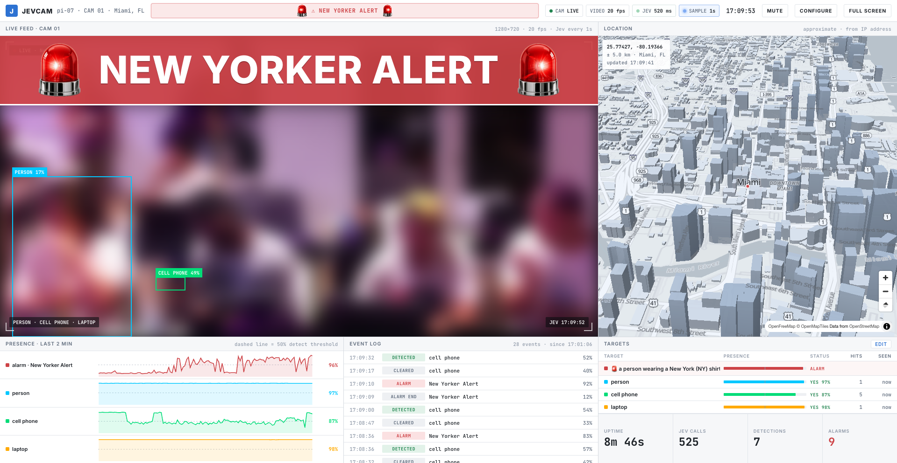
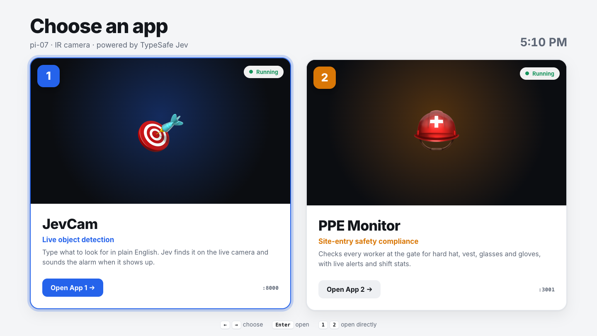
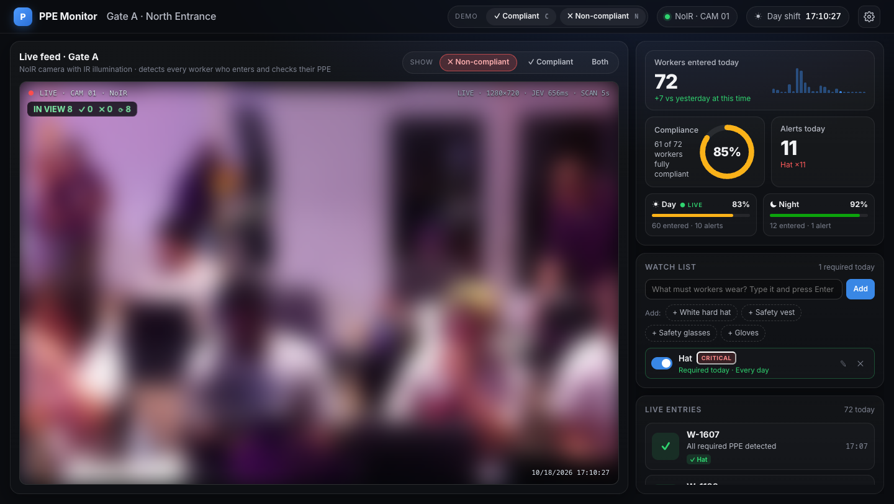
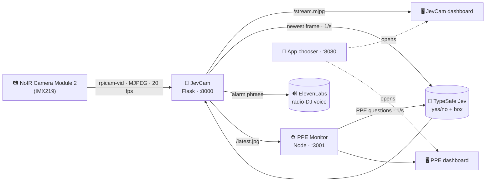

<div align="center">


# JevCam

### Tell a camera what to look for, in plain English.

A Raspberry Pi 4 and an infrared camera that stream live video, ask **TypeSafe Jev** what they see once a second,
and sound a yelling radio-DJ alarm the moment your target walks into frame.
Two apps, one launcher, and the whole thing boots straight into a full-screen kiosk.

<br>


<br>


**[github.com/TheAIMogul/jevcam](https://github.com/TheAIMogul/jevcam)**

</div>

<br>



<sub>Faces in the camera feed are blurred for this README. On the real dashboard the video is live at 20 fps.</sub>

---

## The URLs

Everything runs on the Pi and is served on your local network.

| What | URL | Port |
|---|---|---|
| 🚀 **App chooser** (start here) | **http://pi-07.local:8080** | 8080 |
| 🎯 **App 1 · JevCam** (live object detection) | http://pi-07.local:8000 | 8000 |
| ⛑️ **App 2 · PPE Monitor** (site-entry safety) | http://pi-07.local:3001 | 3001 |
| 📹 Raw camera stream (MJPEG, 20 fps) | http://pi-07.local:8000/stream.mjpg | 8000 |
| 🖼️ Newest single frame | http://pi-07.local:8000/latest.jpg | 8000 |

The Pi's own screen opens the chooser full-screen at boot. If `pi-07.local` doesn't resolve on your
network, use the Pi's IP address instead.

---

## What's inside

<table>
<tr>
<td width="50%" valign="top">

### 🎯 App 1 · JevCam
**Type what to look for. Jev finds it.**

- Live **20 fps** video from the NoIR camera
- Jev checks the newest frame **once a second** against your list of targets in plain English:
  *"a person wearing a mask"*, *"a delivery package"*, *"a dog"*
- Boxes drawn over the live video, plus a presence bar for every target
- **Alarm target + phrase**: when it shows up, a full-width band slides over the feed and a
  **yelling radio-DJ voice** (ElevenLabs) repeats the phrase every 10 s
- **3D map** of the camera's location with buildings at their real heights
- Ops dashboard: 2-minute presence timeline, event log, targets table, totals
- **JEV** and **SAMPLE** lights blink on every Jev answer and every frame sent to Jev

</td>
<td width="50%" valign="top">

### ⛑️ App 2 · PPE Monitor
**Is every worker at the gate wearing their gear?**

- Same live camera, wired to Jev
- Asks about *the person closest to the camera*: are they there, where are they, and are they
  wearing each item on the watch list
- **SCANNING** box, then a verdict that locks green ✓ or red ✗ after two answers
- Every entry logged with a snapshot of the real frame as evidence
- Watch list starts empty: type what workers must wear and press Enter
- Supervisors can amend a verdict by clicking its chip
- Compliance ring, alerts, day/night shift stats, phone pushes via ntfy

</td>
</tr>
</table>

### 🚀 The app chooser



Boots full-screen on the Pi. Arrow keys choose, **Enter** opens, **1** / **2** open directly. The chosen
app runs full-screen, and the **⌂ Apps** button (bottom left) brings you back.

### ⛑️ PPE Monitor



---

## How it works



1. **One camera, one owner.** Only one process can hold the Pi camera, so JevCam runs a single
   long-lived `rpicam-vid` stream using the Pi's hardware JPEG encoder and re-broadcasts it. Any
   number of apps can read `/stream.mjpg` or `/latest.jpg` at the same time.
2. **Sample, don't stream, to the model.** The video goes to the browser untouched at 20 fps. A
   separate thread sends the newest frame to Jev once a second, so the video never waits on the
   model, and the browser draws the boxes on top.
3. **Typed answers, not text.** Each target becomes a Jev **yes/no question** ("Is there a dog
   clearly visible?") plus a **box question** ("the dog"). Answers come back as probabilities and
   0–1 coordinates, usually in 200–500 ms.
4. **No flicker.** Jev's confidence can hover around 50%. The alarm holds for 6 s after the last
   confident frame, and a target only counts as gone after 5 s, so nothing flaps on and off.
5. **Self-healing camera.** If the ribbon cable blips and frames stop, a watchdog restarts the
   stream within seconds and the page reconnects on its own.

---

## Hardware

| Part | Notes |
|---|---|
| Raspberry Pi 4 Model B (4 GB) | Debian 13 (trixie), labwc desktop for the kiosk |
| Camera Module 2 **NoIR** (IMX219) | No IR filter: works in the dark with an IR light, pink tint in daylight |
| A screen or projector *(optional)* | The chooser opens full-screen on it at boot |

> **Camera not detected?** `rpicam-hello --list-cameras` says *No cameras available* and `dmesg`
> shows `imx219 ... -EREMOTEIO` → the ribbon cable isn't seated. Lift the clip, push the cable in
> square (blue side toward the USB ports at the Pi end), and press the clip down.

---

## Set it up on a Pi

```bash
# 1. Camera: add to /boot/firmware/config.txt, then reboot
dtoverlay=imx219

# 2. Code
git clone https://github.com/TheAIMogul/jevcam.git ~/jevcam-src
mkdir -p ~/jevcam
cp -r ~/jevcam-src/{app.py,index.html,static,jevcam.service} ~/jevcam/
cp -r ~/jevcam-src/chooser ~/chooser
cp -r ~/jevcam-src/app2 ~/app2

# 3. Python deps (system site-packages for the camera stack)
cd ~/jevcam && python3 -m venv --system-site-packages .venv && .venv/bin/pip install flask requests

# 4. Keys: never committed, read from these files (chmod 600)
mkdir -p ~/.config/typesafe ~/.config/elevenlabs
echo "<your TypeSafe key>"   > ~/.config/typesafe/api-key
echo "<your ElevenLabs key>" > ~/.config/elevenlabs/theberkleytwins-api-key
chmod 600 ~/.config/typesafe/api-key ~/.config/elevenlabs/*

# 5. Start everything at boot
sudo cp ~/jevcam/jevcam.service ~/chooser/chooser.service ~/chooser/app2.service /etc/systemd/system/
sudo systemctl daemon-reload && sudo systemctl enable --now jevcam app2 chooser

# 6. Kiosk: open the chooser full-screen at desktop login
mkdir -p ~/.config/autostart && cp ~/chooser/pi07-chooser.desktop ~/.config/autostart/
```

The unit files assume the user `hacker7`; change `User=` and the paths if yours differs.

---

## API

<details>
<summary><b>JevCam · :8000</b></summary>

| Method | Path | Returns |
|---|---|---|
| GET | `/stream.mjpg` | Live MJPEG stream, 1280×720 @ 20 fps |
| GET | `/latest.jpg` | Newest camera frame |
| GET | `/api/state` | Detections, boxes, alarm, latency, video fps, camera status, config |
| GET | `/api/timeline` | Last ~4 min of presence samples, event log, hit and alarm counts |
| POST | `/api/config` | `{targets, interval, running, alert_target, alert_phrase, alert_enabled}` |
| GET | `/api/alert_audio?phrase=…` | The alarm phrase as an MP3 (cached per phrase) |

</details>

<details>
<summary><b>PPE Monitor · :3001</b></summary>

| Method | Path | Returns |
|---|---|---|
| GET | `/api/vision` | Latest Jev answer: person presence and box, per-item confidence |
| POST | `/api/vision/items` | Set the watch list Jev checks for |
| GET | `/api/vision/frame.jpg` | The exact frame Jev judged (used for evidence snapshots) |
| GET | `/api/state` · `/api/stream` | Dashboard state and live server-sent events |

</details>

<details>
<summary><b>App chooser · :8080</b></summary>

| Method | Path | Returns |
|---|---|---|
| GET | `/api/apps` | The apps in `chooser/apps.json` |
| GET | `/api/status` | Running / offline for each app |

Add an app by adding an entry to `chooser/apps.json` (a port and a health path that returns 200).

</details>

---

## Project layout

```
.
├── app.py               App 1 · JevCam server: camera stream, Jev sampler, timeline, alarm voice
├── index.html           App 1 · dashboard (live feed, 3D map, timeline, event log, targets)
├── jevcam.service       systemd unit for App 1
├── static/siren.gif     the spinning siren (made with Grok Imagine)
├── app2/                App 2 · PPE Monitor (Node server + dashboard)
├── chooser/             app chooser, its systemd units, and the kiosk launcher
├── assets/siren-src/    Grok keyframes + the script that builds the transparent GIF
└── docs/                README screenshots
```

---

## Built with

- **[TypeSafe Jev](https://docs.typesafe.ai)**: typed yes/no and box answers about each frame
- **[ElevenLabs](https://elevenlabs.io)**: the "David Hertal · Radio DJ" voice, `eleven_v3` with a `[shouting]` tag,
  run through a Web Audio radio filter
- **[MapLibre GL JS](https://maplibre.org)** + **[OpenFreeMap](https://openfreemap.org)**: 3D map with
  © [OpenMapTiles](https://openmaptiles.org) © [OpenStreetMap](https://www.openstreetmap.org/copyright) contributors
- **Grok Imagine** (xAI): the siren artwork, keyed to transparency and animated
- **Raspberry Pi** `rpicam-apps`, Flask, Node.js, Chromium kiosk on labwc

<div align="center">
<br>

<br>
<sub>Built at a hackathon.</sub>
</div>
